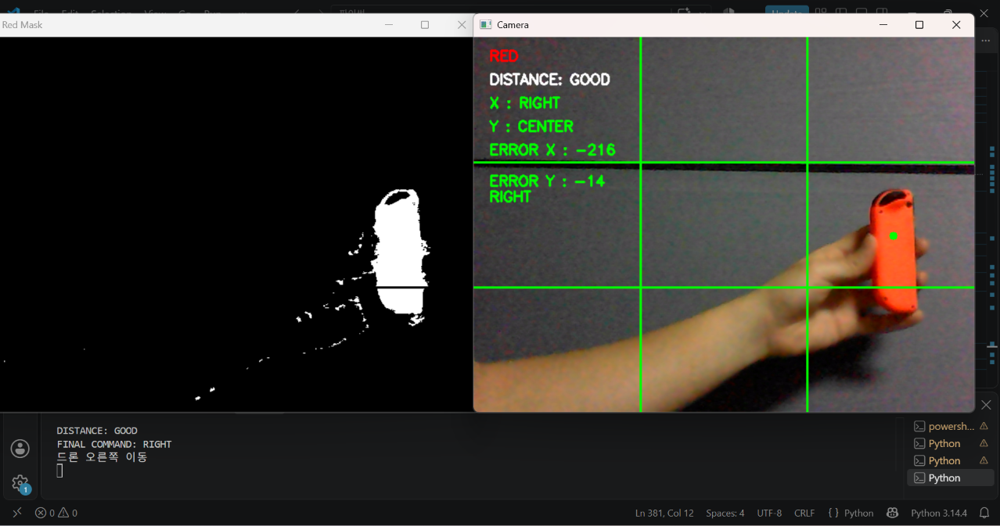

# OpenCV Project 01 - Color Tracking(2026.07 ~ 2026.11.16)
Python과 OpenCV를 활용하여 객체를 인식하고,
객체의 중심 좌표와 화면 내 위치를 계산하는 프로젝트입니다.

향후 드론 자율비행 및 객체 추적 시스템 구현을 위한
기초 영상처리 기술을 학습하는 것을 목표로 제작하였다.

## Projects

### 1. Face Detection

- Haar Cascade를 이용한 얼굴 인식
- 카메라 영상에서 얼굴 개수 검출
- 검출된 얼굴 개수 표시

사용 기술:
- Python
- OpenCV
- Haar Cascade

### 2. Color Detection & Position Detection

카메라 영상에서 특정 색상을 인식하고 객체의 위치를 판단하는 프로젝트입니다.

구현 기능:

- Red 색상 인식
- HSV 색 공간 변환
- Mask 생성
- Contour 검출
- 객체 중심 좌표 계산
- 화면 3×3 Grid 분할
- 객체 위치 판단

위치 판단 방식:

LEFT TOP
CENTER TOP
RIGHT TOP

LEFT CENTER
CENTER
RIGHT CENTER

LEFT BOTTOM
CENTER BOTTOM
RIGHT BOTTOM

사용 기술:

- Python
- OpenCV
- HSV Color Detection
- Contour Detection

### 3. Object Tracking & Drone Movement Command

카메라를 통해 빨간색 객체를 인식하고, 객체의 화면 내 위치와 크기를 이용하여 드론의 이동 방향 및 거리 상태를 판단하는 기능을 구현하였다.

구현 기능:

- 객체 중심 좌표와 화면 중심 사이의 오차 계산
- 객체 위치에 따른 이동 방향 판단
- 객체 크기를 이용한 거리 상태 추정 (FAR / GOOD / NEAR)
- 위치와 거리 정보를 결합한 최종 이동 명령 생성
- 드론 이동 명령을 함수로 분리하여 관리
- 객체가 검출되지 않을 때 STOP 명령 출력
- 이전 명령과 비교하여 명령이 변경된 경우에만 출력
- EMA를 이용한 객체 중심 좌표의 흔들림 완화

이동 명령 예시:

RIGHT / LEFT / UP / DOWN
FORWARD / BACKWARD
RIGHT + FORWARD
LEFT + BACKWARD
CENTER / STOP

거리 상태 판단 방식:

FAR: 객체가 화면에서 상대적으로 작게 검출되는 상태
GOOD: 객체가 적정 크기로 검출되는 상태
NEAR: 객체가 화면에서 상대적으로 크게 검출되는 상태

객체의 Bounding Box 면적을 이용한 상대적인 거리 상태 추정이며 실제 거리를 측정하는 기능은 아님

최종 테스트 결과:

카메라 앞에서 빨간색 객체의 위치와 크기를 변경하며 이동 명령이 정상적으로 생성되는지 확인했다.

실제 드론과 연결한 비행 제어는 수행하지 않고 생성된 이동 명령을 터미널에 출력하여 동작을 확인했다.

### 4. Development Environment

- Python
- OpenCV
- Visual Studio Code

### 5. Future Improvements

- 객체 검출 및 이동 명령 안정성 개선
- 실제 드론 비행 제어 시스템과 연동
- 거리 추정 정확도 개선
- 실시간 자율비행 시스템 적용

### 6. 어려웠던 점

- 객체 중심 좌표 계산

처음에는 boundingRect()로 얻은 (x, y)가 객체의 중심 좌표인 줄 알았다. 공부하면서 (x, y)는 객체의 왼쪽 위 좌표이고, 중심 좌표는 x + w // 2, y + h // 2로 계산해야 한다는 것을 이해했다.

- 화면 좌표계 이해

수학 좌표와 OpenCV 좌표가 달라 처음에는 위치를 판단하는 과정에서 혼란이 있었다. OpenCV에서는 좌측 상단이 원점(0, 0)이며, x축은 오른쪽으로 증가하고 y축은 아래쪽으로 증가한다는 점이 지금까지 배워왔던 수학과 달라서 헷갈렸고 이후 좌표계를 이해한 뒤 위치 판단 조건을 올바르게 작성할 수 있었다

- 화면을 3×3으로 분할하는 조건 작성

if문으로 각 영역의 조건을 작성하는 과정에서 어떤 기준으로 나눠야 하는지 많이 헷갈렸다. 또한 객체의 중심 좌표가 화면에서 왼쪽으로 이동하면 x값이 작아지고, 오른쪽으로 이동하면 x값이 커진다는 좌표 개념이 위에 문제의 이유로 완전히 이해되지 않아 조건문을 작성하는 데 어려움을 겪었다. 이후 width // 3, (width * 2) // 3, height // 3, (height * 2) // 3를 이용해 화면을 3등분하는 방법을 이해하면서 원하는 위치를 정확하게 판단할 수 있었다

- 조건문의 위치

아직도 코드를 작성하다 보면 변수와 조건문을 어디에 작성해야 하는지 헷갈릴 때가 많다. 또한 위에서 만든 변수가 어떤 목적으로 만들어졌는지 기억이 나지 않아 같은 내용을 다시 찾아보는 경우도 있었다. 코드를 여러 번 수정하고 실행해 보면서 변수의 역할과 조건문의 실행 순서를 조금씩 이해하게 되었다.

- Contour 가장 큰 객체 선택 및 인식의 문제점

빨간 물체를 카메라에 비추면 빨간색 영역이 여러 개 검출되는 경우가 있어서 인식할 때 문제가 많았다. if red_contours: 는 빨간물체가 하나라도 있으면 이라는 뜻인데 max를 일단 빨간물체가 없는데 그냥 쓰면 오류가 났다. 그래서 if red_contours: 이걸로 먼저 빨간게 있는지 확인해보고 그 후 지금 if red_contours: 이걸쓰면 너무 많은 빨간점 팔같이 불필여한게 인식되기때문에 max라는 함수를 사용해서 red_contours안에서 가장큰 것 하나만 선택하게 했다. cv2.contourArea() 이건 contour에 면적을 계산하는 함수도 이용할수있었다.

- error_x의 의미와 부호 이해

error_x, error_y의 움직임이 기존에 이해했던 좌표와 또 달라서 헷갈리는 점이 있었다. error_x = screen_center_x - red_center_x처럼 화면 중심 좌표에서 물체 중심 좌표를 빼서 계산하기 때문에 실제 물체 좌표와 부호가 반대로 나타난다는 것을 이해했다. 따라서 error_x는 -이면 물체가 화면 중심보다 오른쪽에 있고, +이면 왼쪽에 있다고 확인할수있었다.

- 이동 방향 판단과 화면 출력 분리

기존에는 이동 방향을 판단하는 조건문 안에서 `cv2.putText()`를 직접 실행했었다. 나중에는 move_direction에 변수에 판단 결과를 저장하고, 조건문이 끝난 뒤 해당 변수를 화면에 출력하도록 변경했다.

이건 이동 방향을 판단하는 부분과 출력하는 부분을 분리하기 위한 것이다. 나중에 `move_direction`이 실제 드론 제어 할때 연결하기 쉽게 만들었다.

- 객체가 없을 때 명령이 남을 가능성

객체가 카메라 화면에서 사라졌을 때 이전 이동 명령이 계속 남을 가능성이 있었다. 객체가 검출되지 않는 상황에서도 이전에 저장된 이동 방향이 초기화되지 않을 수 있었다. 해결후 객체가 사라졌을 때 정지 명령이 출력되는 것을 확인하였다.

- 터미널에 명령이 반복 출력되는 문제

드론 이동 명령이 터미널에 반복적으로 출력되었다. 카메라 영상은 매 프레임마다 처리되기 때문에 같은 이동 명령도 계속 출력되었다 그래서 터미널을 보고 결과가 잘 나왔는지 확인하는 부분에서 조금의 불편함이 있었다. 해결후 같은 명령이 반복해서 출력되는 현상을 줄일 수 있었다.

- 가까이서 객체의 중심점이 튀는 문제

객체가 카메라에 가까이 있을 때 중심점이 불규칙하게 움직이는 현상이 나타났다. 바운딩 박스의 크기와 위치가 프레임마다 조금씩 변하면서 중심 좌표에도 흔들림이 발생하였다. 그래서 터미널에 불필요한 내용이 출력되었다. 해결후 중심점의 갑작스러운 움직임이 줄어들고 객체 위치를 더 부드럽게 추적할 수 있었다.

### 7. 해결 방법

* `boundingRect()`와 중심 좌표 계산 방법을 다시 학습하였다.
* OpenCV 좌표계를 직접 그림으로 정리하여 x축과 y축의 증가 방향을 이해하였다.
* 화면을 일정한 비율로 나누는 방법을 적용하여 3×3 Grid를 구현하였다.
* 코드를 여러 번 수정하고 실행하면서 변수의 역할과 조건문의 실행 순서를 이해하였다.
* max함수와 cv2.contourArea()이용해 해결해볼수있었다.
* 검출이 상실되거나 객체의 크기가 기준보다 작아지면 상태를 초기화하고 move_direction = "STOP"으로 처리하였다.
* 이전 명령과 현재 명령을 비교하여 명령이 변경된 경우에만 출력하도록 수정하였다.
* 이전 중심 좌표와 현재 중심 좌표를 일정 비율로 반영하는 EMA 스무딩을 적용하고 alpha = 0.3으로 설정하였다.

**최종 테스트 결과:**

카메라 앞에서 빨간색 객체의 위치와 거리를 변경하며 이동 명령이 정상적으로 생성되는지 확인하였다.

